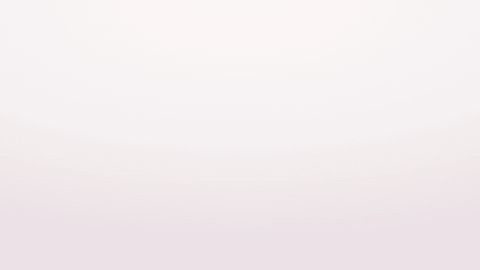
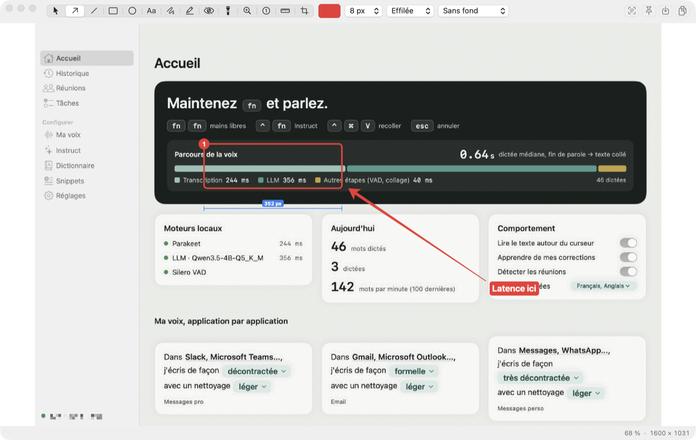
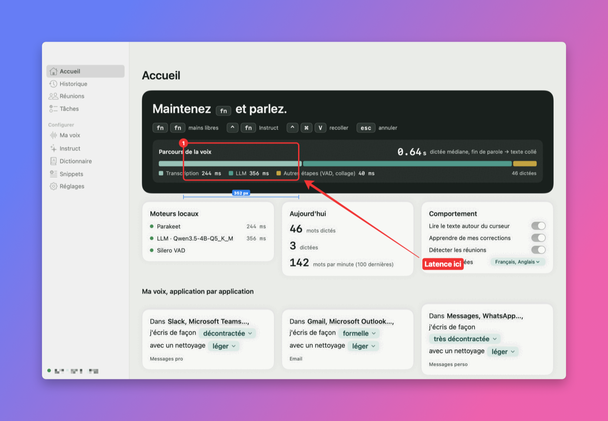
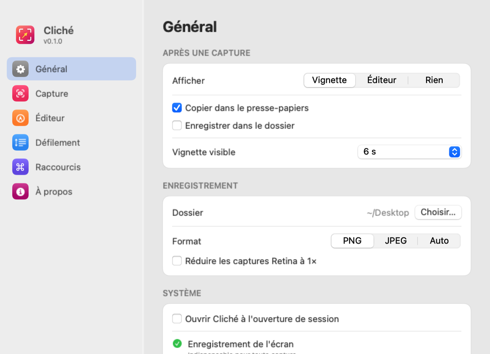

<div align="center">


# Cliché

**Captures d'écran open source pour macOS. Capturer, annoter, mesurer.**

[**Télécharger**](https://github.com/samr037/cliche/releases/latest) · [English](README.md)



</div>

Cliché vit dans la barre des menus. Un raccourci, une zone, et la capture est dans le presse-papiers ; la vignette qui apparaît ouvre l'éditeur. App Swift native : aucun compte, aucun envoi, aucune télémétrie.

## Ce que fait Cliché

<picture>
  <source media="(prefers-color-scheme: dark)" srcset="docs/media/fr/editor-dark.png">
  
</picture>

- **Captures** : zone (écran figé, loupe ×8, taille et couleur sous le curseur), plein écran, fenêtre (fond transparent, ombre au choix), différée, répétition de la dernière zone, **capture défilante** (Cliché fait défiler la page et recolle les images), **texte et QR codes** (Vision, sur le Mac).
- **14 outils d'annotation** : flèche, ligne, rectangle, ovale, texte, main levée avec **correction de forme**, surligneur, **flou / pixels / effacement**, projecteur, loupe, étapes numérotées, **règle intelligente**, recadrage.
- **Mesure et couleurs** : la règle trouve seule les bords (⌥ + molette règle la sensibilité) ; la barre d'état donne la couleur en HEX, RGB, HSL, HSB, OKLCH, SwiftUI ou NSColor et le contraste WCAG.
- **Partage** : copier, enregistrer (PNG, JPEG, auto), glisser la vignette, **épingler** au-dessus des fenêtres, **fonds décoratifs** (dégradés, mesh, couleur unie).

<p align="center"></p>

## Réglages

<picture>
  <source media="(prefers-color-scheme: dark)" srcset="docs/media/fr/settings-general-dark.png">
  
</picture>

## Langues

Cliché parle français, anglais, allemand, espagnol, italien, portugais du Brésil, japonais et chinois simplifié. Il suit la langue de macOS, avec l'anglais par défaut. Les traductions partagent un [glossaire](docs/l10n-glossary.md) ; la CI vérifie qu'aucun texte ne manque.

## Raccourcis

⇧⌘1 plein écran · ⇧⌘2 zone · ⇧⌘6 fenêtre · ⇧⌘7 défilante · ⇧⌘8 texte (OCR) · ⇧⌘9 répéter la zone. Tous modifiables dans Réglages › Raccourcis.

Dans l'éditeur : V sélection, A flèche, L ligne, R rectangle, O ovale, T texte, D main levée, H surligneur, B masquer, S projecteur, M loupe, N compteur, 1 règle, C recadrer, Échap copie et ferme.

## Installer

1. Téléchargez `Cliche-x.y.z.dmg` dans les [Releases](https://github.com/samr037/cliche/releases/latest) et glissez Cliché dans Applications.
2. Première ouverture : Réglages Système › Confidentialité et sécurité › **Ouvrir quand même** (app non notariée).
3. Autorisez **Enregistrement de l'écran** ; la capture défilante demande aussi **Accessibilité**.

Vérifier la provenance : `gh attestation verify Cliche-0.1.0.dmg -R samr037/cliche`

## Compiler

```sh
scripts/test.sh
CLICHE_SIGN=- scripts/build-app.sh
scripts/make-dmg.sh ~/Applications/Cliché.app dist/Cliche.dmg
```

Projet indépendant inspiré de [Shottr](https://shottr.cc), sans lien avec lui. [Licence MIT](LICENSE).
