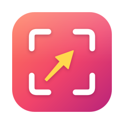
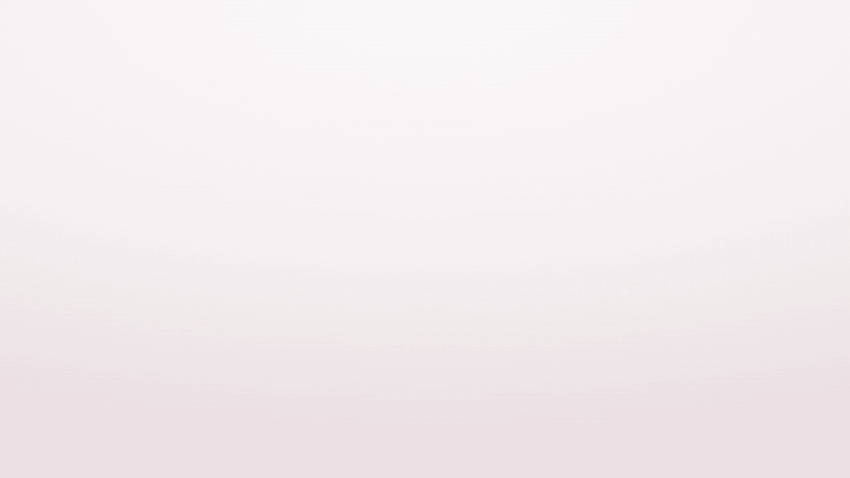
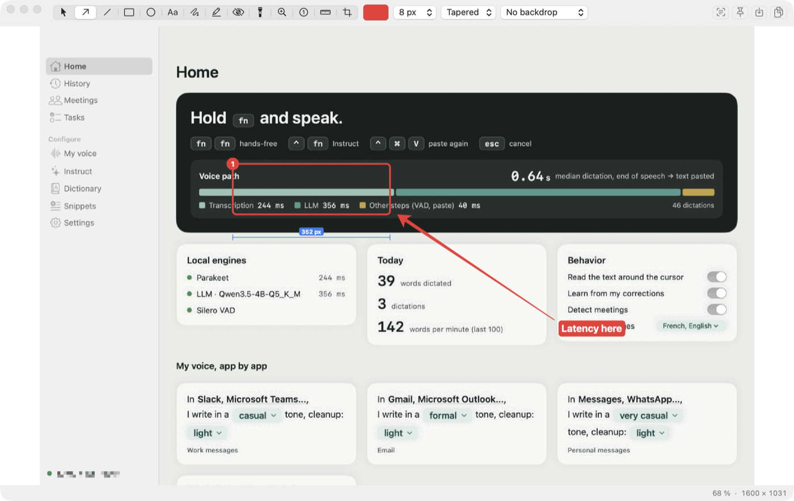
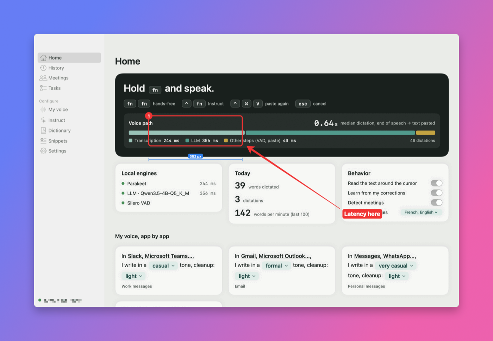
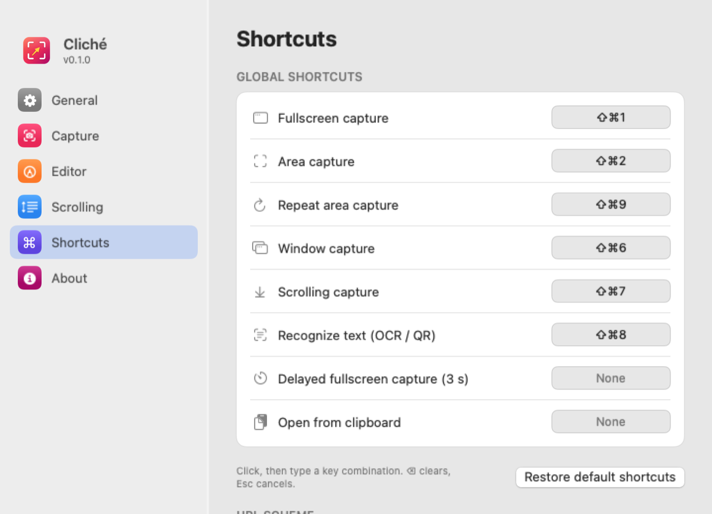

<div align="center">



# Cliché

**Open-source screenshots for macOS. Capture, annotate, measure.**

[](https://github.com/samr037/cliche/actions/workflows/ci.yml)
[](https://github.com/samr037/cliche/actions/workflows/security.yml)
[](https://github.com/samr037/cliche/releases/latest)

[](LICENSE)

[**Download**](https://github.com/samr037/cliche/releases/latest) · [Features](#features) · [Shortcuts](#shortcuts) · [Build](#build-from-source) · [Français](README.fr.md)



</div>

Cliché lives in your menu bar. Press a shortcut, pick an area, and the screenshot is on your clipboard, with a small thumbnail you can click to annotate. It's a native Swift app with no account, no upload and no telemetry. Everything runs on your Mac.

## Features

<picture>
  <source media="(prefers-color-scheme: dark)" srcset="docs/media/en/editor-dark.png">
  
</picture>

**Capture**
- **Area** on a frozen screen, with a ×8 pixel loupe, live size and color under the cursor. Press Enter for the whole screen.
- **Fullscreen**, **window** (transparent background, shadow optional), **delayed** (3 s), **repeat last area**.
- **Scrolling capture**: Cliché scrolls the page for you and stitches the frames, keeping sticky headers and footers only once.
- **Text and QR codes**: select an area and the text is on your clipboard (Apple Vision, on-device).

**Annotate**: 14 tools, each with a one-key shortcut.
Arrow (tapered, line, double, open) · line · rectangle · oval · text (plain, label, outline) · freehand with **shape correction** (a wobbly circle becomes an ellipse) · highlighter · **blur / pixelate / erase** · spotlight · magnifier · numbered steps · **smart ruler** · crop.

**Measure and pick**
- The **smart ruler** finds edges by itself: hover to see the distance to the next edge in all four directions, click to pin both measurements. ⌥ + scroll adjusts sensitivity.
- The status bar shows the pixel position, its color (HEX, RGB, HSL, HSB, OKLCH, SwiftUI, NSColor) and the WCAG contrast ratio.

**Share**
- Copy, save (PNG, JPEG or auto), drag the thumbnail into any app, or **pin** the image above all windows (scroll to zoom, ⌥ + scroll for opacity).
- **Backdrops** for social posts: gradients, mesh, solid, with padding, rounded corners and shadow.

<p align="center"></p>

## Languages

Cliché speaks English, French, German, Spanish, Italian, Brazilian Portuguese, Japanese and Simplified Chinese. It follows your macOS language and falls back to English. Translations share a [glossary](docs/l10n-glossary.md) and use Apple's own wording for system names. CI checks that every language has every string with matching placeholders. Corrections are welcome.

## Settings

<picture>
  <source media="(prefers-color-scheme: dark)" srcset="docs/media/en/settings-shortcuts-dark.png">
  
</picture>

Every global shortcut can be re-recorded. Cliché flags shortcuts that another app has already taken. Also configurable: after-capture behavior, save folder and format, Retina downscaling, default color and stroke, scrolling speed and height limit, launch at login.

## Shortcuts

| Global | Default | | Editor | Key |
|---|---|---|---|---|
| Fullscreen capture | ⇧⌘1 | | Select | V |
| Area capture | ⇧⌘2 | | Arrow · Line | A · L |
| Window capture | ⇧⌘6 | | Rectangle · Oval | R · O |
| Scrolling capture | ⇧⌘7 | | Text · Freehand | T · D |
| Recognize text (OCR / QR) | ⇧⌘8 | | Highlighter · Conceal | H · B |
| Repeat area capture | ⇧⌘9 | | Spotlight · Magnifier | S · M |
| | | | Counter · Ruler · Crop | N · 1 · C |
| | | | Copy & close | Esc |

Hold ⇧ to snap lines to 45° and rectangles to squares. ⌘Z / ⇧⌘Z undo and redo, and the arrow keys nudge the selected object (×10 with ⇧).

**Automation**: after you allow it once, `open "cliche://grab/area"` works from Shortcuts, Raycast or Alfred. Commands are `grab/fullscreen`, `grab/area`, `grab/area/repeat`, `grab/window`, `grab/scrolling`, `grab/delayed`, `ocr` and `load/clipboard`.

## Install

1. Download `Cliche-x.y.z.dmg` from [Releases](https://github.com/samr037/cliche/releases/latest) and drag Cliché to Applications.
2. The first time you open it, go to System Settings › Privacy & Security › **Open Anyway**. The app is not notarized by Apple.
3. Allow **Screen Recording**. Scrolling capture also needs **Accessibility**.

Want the latest changes? [**Nightly**](https://github.com/samr037/cliche/releases/tag/nightly) is rebuilt automatically from `main` after every code change (`Cliche-nightly.dmg`). It's untested work in progress.

Check that a DMG really comes from this repository's CI:

```sh
gh attestation verify Cliche-0.1.0.dmg -R samr037/cliche
```

## Build from source

Requirements: macOS 14+ and Swift 5.10 or later (Xcode or the Command Line Tools).

```sh
scripts/test.sh                          # unit and security tests (ClicheCore)
CLICHE_SIGN=- scripts/build-app.sh       # ~/Applications/Cliché.app, ad hoc signed
scripts/make-dmg.sh ~/Applications/Cliché.app dist/Cliche.dmg
```

**Releasing:** add your changes under *Unreleased* in [CHANGELOG.md](CHANGELOG.md), then run `scripts/release.sh 0.3.0`. The script checks the tree, runs the tests, bumps the version, tags and pushes. CI builds the DMG and publishes the release, with notes taken from the changelog.

Tip: sign with a stable local certificate (`CLICHE_SIGN="My Dev Cert"`). macOS ties the Screen Recording permission to the signature, so an ad hoc build asks again after every rebuild.

| Module | What it does |
|---|---|
| `Sources/ClicheCore` | Annotation model, CoreGraphics renderer, smart ruler, scroll stitcher, shape recognizer, colors and contrast, backdrops, export, input validation. Has no AppKit dependency and is fully tested. |
| `Sources/Cliche` | Menu bar app: ScreenCaptureKit capture, area and window picker, editor, thumbnail, pins, OCR, settings (SwiftUI), global hotkeys. |

## Security

Each push runs the [tests](.github/workflows/ci.yml) and a [security workflow](.github/workflows/security.yml). That workflow runs CodeQL (`security-extended`) on the Swift code, scans the full git history for leaked secrets with gitleaks, and runs OpenSSF Scorecard. Every action is pinned to a commit SHA, and Dependabot keeps those pins current. Releases carry a signed build-provenance attestation (Sigstore).

`cliche://` links are refused until you allow them, and they only accept a fixed list of commands with no parameters. See [SECURITY.md](SECURITY.md) to report a vulnerability.

## Credits

Cliché is an independent project, inspired by the excellent [Shottr](https://shottr.cc). It is not affiliated with Shottr. If you want a polished commercial tool with cloud sharing, buy Shottr.

[MIT License](LICENSE) © 2026 Samy Jacquet
